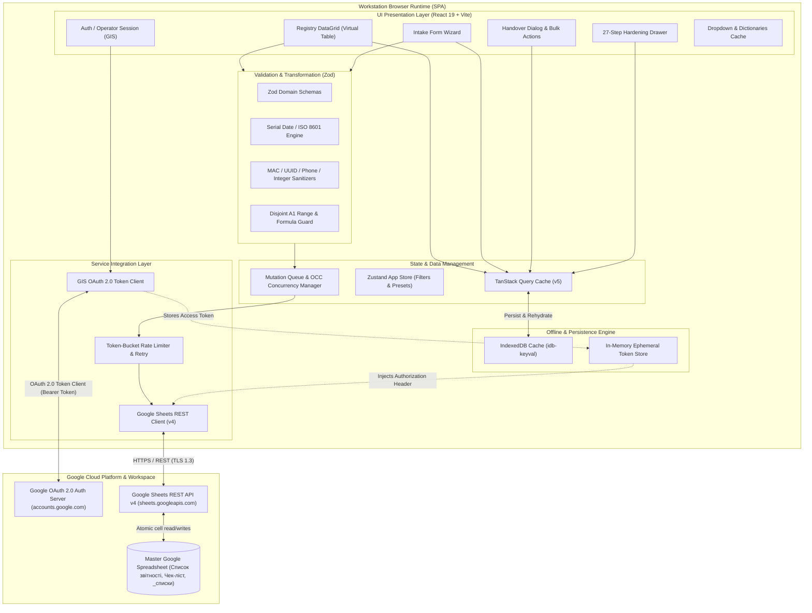
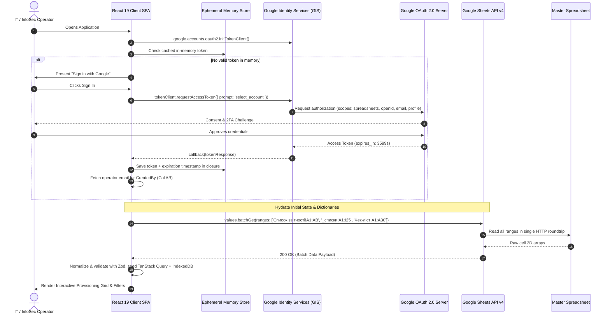
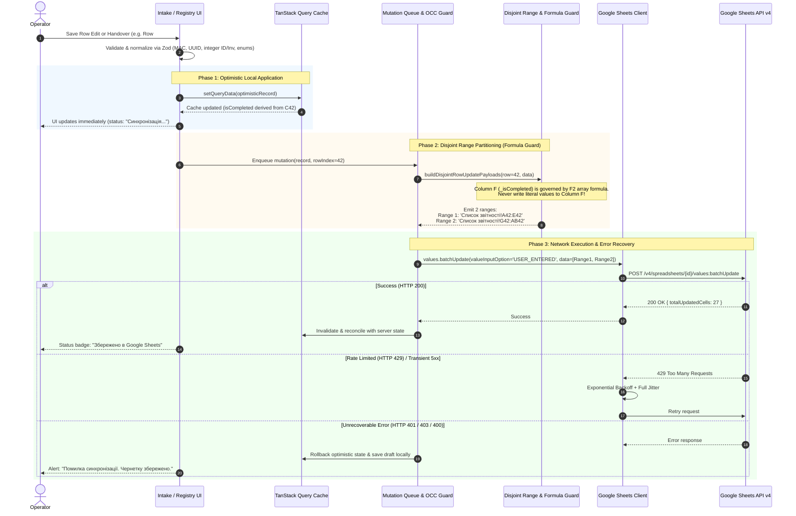

# Laptop Provisioning & Security Configuration Accounting Tool (`Облік опрацьованих лептопів`)
## System Architecture Proposal

**Related Documents:**
- [PRODUCT-BRIEF.md](../PRODUCT-BRIEF.md)
- [docs/ACCEPTANCE-BRIEF.md](./ACCEPTANCE-BRIEF.md)
- [docs/adr/README.md](./adr/README.md)

---

### Executive Summary

The **Laptop Provisioning & Security Configuration Accounting Tool** (`Облік опрацьованих лептопів`) is a client-side web application designed for IT and InfoSec provisioning units (ЦРЦТіЦ / НСЗІ). It streamlines workstation intake, 27-step OS/security hardening (`Чек-ліст`), operational handover, and configuration auditing (`Список звітності`).

The application uses a **serverless Single-Page Application (SPA) architecture** built on **React 19**, **Vite**, and **TypeScript**, backed directly by a collaborative **Google Spreadsheet** using the **Google Sheets REST API v4** and **Google Identity Services (GIS) OAuth 2.0** ([ADR-0001](./adr/0001-frontend-only-spa-with-google-sheets-backend.md), [ADR-0002](./adr/0002-google-identity-services-oauth2-auth.md)). This eliminates backend infrastructure overhead, maintains zero database hosting costs, provides built-in access control via Google Drive ACLs, and preserves direct spreadsheet access for leadership while enforcing strict client-side schema normalization, formula-safe writes ([ADR-0003](./adr/0003-sheet-schema-and-formula-safe-updates.md)), and security hygiene.

---

## 1. High-Level System Architecture & Mermaid Diagrams

### 1.1 Architecture Overview

The system runs entirely client-side in the operator's browser runtime. It interfaces with Google Cloud APIs through authenticated REST endpoints while managing local state, caching, and offline buffering via **TanStack Query v5** backed by **IndexedDB**.



---

### 1.2 Google Identity Services (GIS) & Sheets API v4 Lifecycle

The authentication lifecycle uses the Google Identity Services (GIS) Token Client. Access tokens are held exclusively in volatile memory to mitigate Cross-Site Scripting (XSS) token theft ([ADR-0002](./adr/0002-google-identity-services-oauth2-auth.md)).



---

### 1.3 Data Sync, Optimistic Mutation, and Formula Guard Flow

Column `F` (`_isCompleted`) in `Список звітності` is powered by an array formula in cell `F2`:
`=IF(ROW(C2:C1024)<=MAX(ROW(C2:C1024)*(C2:C1024<>"")), C2:C1024<>"", "")`
Writing directly to column `F` would overwrite the formula or cause a `#REF!` spill collision. The Formula Guard splits row updates into two disjoint ranges (`A{row}:E{row}` and `G{row}:AB{row}`) executed in a single `values.batchUpdate` call.



---

## 2. Frontend Module & Folder Structure

The codebase follows a **Feature-Driven Architecture** with high cohesion, low coupling, and strict immutability:

```text
src/
├── app/                                    # Application bootstrap & providers
│   ├── App.tsx                             # Root layout, header, error boundary
│   ├── Providers.tsx                       # TanStack Query, AuthProvider, Toast provider
│   └── main.tsx                            # Vite entry point
├── components/                             # Reusable, domain-agnostic UI primitives
│   ├── Button/
│   ├── DataGrid/                           # Virtualized table with sticky header & inline edit
│   ├── Dialog/
│   ├── Dropdown/
│   └── StatusBadge/                        # Visual badges for _isCompleted, ГОД, Мережа
├── config/                                 # Runtime configuration
│   ├── env.ts                              # Validated VITE_GOOGLE_CLIENT_ID & VITE_SPREADSHEET_ID
│   └── sheetsConfig.ts                     # Sheet tab names & column coordinate constants
├── features/
│   ├── auth/                               # Google Identity Services (GIS) OAuth 2.0
│   │   ├── components/
│   │   │   ├── AuthButton.tsx
│   │   │   └── OperatorSessionBar.tsx      # Active operator email & default НСЗІ preset
│   │   ├── context/
│   │   │   └── AuthProvider.tsx            # In-memory token store & silent refresh timer
│   │   └── hooks/
│   │       └── useAuth.ts
│   ├── registry/                           # Main Provisioning Registry (Список звітності)
│   │   ├── components/
│   │   │   ├── RegistryKpiBar.tsx          # Total, Completed, In-Progress, Checklist %
│   │   │   ├── RegistryFilterBar.tsx       # Search (MAC/Hostname/Inv#) + 6 dropdown filters
│   │   │   ├── RegistryGrid.tsx            # 28-column virtualized interactive grid
│   │   │   ├── IntakeModal.tsx             # New laptop intake modal with smart defaults
│   │   │   ├── HandoverModal.tsx           # Single & bulk handover dialog (Cols C, D, E)
│   │   │   └── BulkActionsBar.tsx          # Multi-row batch update toolbar
│   │   └── hooks/
│   │       ├── useRegistryQuery.ts
│   │       ├── useCreateRecord.ts
│   │       └── useUpdateRecord.ts
│   ├── checklist/                          # 27-Step Hardening Checklist (Чек-ліст)
│   │   ├── components/
│   │   │   └── ChecklistDrawer.tsx         # Interactive 27-step verification drawer -> Col AA
│   │   └── hooks/
│   │       └── useChecklist.ts
│   └── dictionaries/                       # Reference lookup lists (_списки)
│       └── hooks/
│           └── useDictionaries.ts          # Loads & caches the 9 dropdown lists
├── schemas/                                # Zod validation & normalization schemas
│   ├── laptopRecordSchema.ts               # 28-column row schema & normalizers
│   ├── dictionarySchema.ts                 # 9 reference list schemas
│   └── checklistSchema.ts                  # 27-step checklist schema
└── services/
    ├── converters/
    │   ├── dateConverter.ts                # Google Sheets serial date <-> ISO 8601 (Europe/Kyiv)
    │   └── normalizers.ts                  # MAC, UUID, integer string ("8.0" -> "8"), phone
    └── sheets/
        ├── sheetsClient.ts                 # Typed REST wrapper for Google Sheets API v4
        ├── sheetsFormulaGuard.ts           # Disjoint range builder preserving Column F
        └── rateLimiter.ts                  # Token-bucket rate limiter & exponential backoff
```

---

## 3. Data Model & Zod Validation Schema

### 3.1 Master Registry Schema (`Список звітності` — 28 Columns `A`..`AB`)

| Col | Index | Header Title (`uk`) | Domain Field | Type & Normalization | Validation / Source |
|:---:|:-----:|:--------------------|:-------------|:---------------------|:--------------------|
| **A** | 0 | `ID` | `id` | `number` (`"8.0"` → `8`) | Positive integer, auto-increment (`max(ID) + 1`) |
| **B** | 1 | `Дата/час прийняття` | `receivedAt` | `string` (ISO 8601) | Converted to/from Sheets serial date (`Europe/Kyiv`) |
| **C** | 2 | `Дата/час видачі` | `issuedAt` | `string \| null` | Empty on intake; set on handover |
| **D** | 3 | `Видано ФІО` | `issuedToName` | `string \| null` | Recipient full name |
| **E** | 4 | `Видано тел.` | `issuedToPhone` | `string \| null` | Normalized phone (`0XXXXXXXXX` / `+380XXXXXXXXX`) |
| **F** | 5 | `_isCompleted` | `isCompleted` | `boolean` (Read-Only) | **Formula-Protected** (`Boolean(issuedAt)`) |
| **G** | 6 | `Підрозділ` | `subdivision` | `string` (Enum) | Lookup: `'_списки'!$E$2:$E$22` |
| **H** | 7 | `Місцезнаходження` | `location` | `string` (Enum) | Lookup: `'_списки'!$F$2:$F$22` |
| **I** | 8 | `Опис ПЕОМ` | `peomDescription` | `string` (Enum) | Lookup: `'_списки'!$G$2:$G$22` |
| **J** | 9 | `Мережа` | `network` | `string` (Enum) | Lookup: `'_списки'!$A$2:$A$20` |
| **K** | 10 | `Тип оновлення` | `updateType` | `string` (Enum) | Lookup: `'_списки'!$B$2:$B$22` |
| **L** | 11 | `ГОД` | `securityClassification` | `string` (Enum) | Lookup: `'_списки'!$C$3:$C$22` |
| **M** | 12 | `Инв.н.` | `inventoryNumber` | `string` (`"27.0"` → `"27"`) | Non-empty string, strips trailing `.0` |
| **N** | 13 | `Тип АС` | `asType` | `string` (Enum) | Lookup: `'_списки'!$D$2:$D$22` |
| **O** | 14 | `Відповідальний` | `responsibleName` | `string` | Responsible custodian full name |
| **P** | 15 | `Звання відповідального` | `responsibleRank` | `string` | Custodian military rank |
| **Q** | 16 | `Тел. відповідального` | `responsiblePhone` | `string` | Custodian phone |
| **R** | 17 | `Імʼя ПЕОМ` | `hostname` | `string` | Hostname (e.g., `DESKTOP-DEMO01`) |
| **S** | 18 | `WiFi MAC` | `wifiMac` | `string` | Normalized uppercase `XX:XX:XX:XX:XX:XX` (or empty if N/A) |
| **T** | 19 | `ESET ProductInstanceID` | `esetInstanceId` | `string` | Lowercase UUID (`xxxxxxxx-xxxx-xxxx-xxxx-xxxxxxxxxxxx`) |
| **U** | 20 | `Військова частина` | `militaryUnit` | `string` (Enum) | Lookup: `'_списки'!$H$2:$H$22` (e.g., `A0000`) |
| **V** | 21 | `НСЗІ звання` | `infosecRank` | `string` | InfoSec officer rank (supports operator preset) |
| **W** | 22 | `НСЗІ ФІО` | `infosecName` | `string` | InfoSec officer full name (supports operator preset) |
| **X** | 23 | `НСЗІ тел` | `infosecPhone` | `string` | InfoSec officer phone (supports operator preset) |
| **Y** | 24 | `Політика` | `policy` | `string` (Enum) | Lookup: `'_списки'!$I$2:$I$20` |
| **Z** | 25 | `Мережа локальна` | `localNetwork` | `string` | Normalizes `ІСД-Интернет` → `ІСД-Інтернет` |
| **AA** | 26 | `Чек-ліст інсталляціі` | `checklistCompleted` | `boolean` | Coerces `"true" \| "1" \| "TRUE"` → `true` |
| **AB** | 27 | `CreatedBy` | `createdBy` | `string` (Email) | Auto-populated from authenticated Google OAuth user |

---

### 3.2 Reference Dictionaries (`_списки` — 9 Lookup Lists)

| Column | Header Title | Sample Values from `_списки` |
|:------:|:-------------|:-----------------------------|
| **A** | `Мережа` | `Без підключення`, `Інтернет`, `Дніпро`, `ЗСУ 002` |
| **B** | `Тип оновлення` | `Автоматично (Інтернет)`, `Автомтично (Дніпро)`, `СЗІвАС` |
| **C** | `ГОД` | `Без обробки`, `НТ(-)`, `НТ`, `ДСК`, `Т`, `ЦТ` |
| **D** | `Тип АС` | `АС-1`, `ІСД-І`, `АРМ Дельта`, `АРМ Віраж`, `АРМ СЕДО`, `АРМ ЕКМ ЗСУ` |
| **E** | `Підрозділ` | `САДн`, `Стрілецький батальйон, звʼязок`, `ЦРЦТіЦ`, `2МБ`, `Штаб` |
| **F** | `Місцезнаходження` | `ППД` (plus any additional locations added to `_списки!F2:F22`) |
| **G** | `Опис ПЕОМ` | `Робочий` (plus any additional descriptions in `_списки!G2:G22`) |
| **H** | `Військова частина` | Synthetic unit codes in `_списки!H2:H22` (e.g. `A0000`) |
| **I** | `Політика` | `АС-1`, `АС-2, 3`, `AC-2, 3 для ПБУ (без скрінсевйеру та ввімкнено Bluetooth)`, `AC-3 Light (тільки парольна політика)` |

---

## 4. Concurrency, Rate Limiting, Caching & Formula Safety

1. **Batch Read Hydration (`spreadsheets.values.batchGet`):**
   - Loads `Список звітності!A1:AB2000`, `_списки!A1:I25`, and `Чек-ліст!A1:A30` in a **single HTTP request** (`valueRenderOption=UNFORMATTED_VALUE`, `dateTimeRenderOption=SERIAL_NUMBER`).
2. **Formula-Safe Disjoint Range Writes (`spreadsheets.values.batchUpdate`):**
   - Because cell `F2` contains the sheet-wide array formula `=IF(ROW(C2:C1024)<=MAX(ROW(C2:C1024)*(C2:C1024<>"")), C2:C1024<>"", "")`, every row update or row creation writes **two disjoint ranges** (`Список звітності!A{row}:E{row}` and `Список звітності!G{row}:AB{row}`) in a single `values.batchUpdate` request, leaving column `F` completely untouched so the array formula automatically computes `_isCompleted` from column `C` (`Дата/час видачі`).
3. **Optimistic Concurrency Verification:**
   - Before writing to row `N`, the client verifies that `Список звітності!A{N}` still matches the expected `record.id` so concurrent insertions or row shifts cannot overwrite the wrong workstation record.
4. **Rate Limiting & Retry:**
   - Token-bucket limiter capped at 50 requests/minute per user (below Google's 60 req/min/user quota) with exponential backoff + full jitter on `429 Too Many Requests` or `503 Service Unavailable`.

---

## 5. Security Architecture

1. **Google Identity Services (GIS) OAuth 2.0:**
   - Uses `google.accounts.oauth2.initTokenClient` with scopes `https://www.googleapis.com/auth/spreadsheets` and `openid email profile`.
   - Access tokens are stored strictly in an **in-memory JavaScript closure** (never written to `localStorage` or `sessionStorage`).
2. **Operator Attribution (`CreatedBy`):**
   - Column `AB` is automatically populated from the signed-in operator's verified Google email on record creation.
3. **Prohibition of Plaintext Credentials in Spreadsheet Cells:**
   - During workbook inspection, `Чек-ліст` cell `B2` contained local setup notes. The web application reads **only Column `A` (`Чек-ліст!A1:A27`)** (the step titles) and never fetches, caches, or renders column `B` (`Чек-ліст!B:B`) in the client UI. Local admin passwords must be managed in a dedicated password manager (e.g., KeePassXC / Vault) and never stored in plaintext spreadsheet cells or repository files.

---

## 6. The 27-Step Provisioning Checklist (`Чек-ліст!A1:A27`)

Completing the 27 steps in the Checklist Drawer sets `Чек-ліст інсталляціі` (Column `AA`) to `TRUE`:

| Step # | Checklist Step Title (`Чек-ліст!A1:A27`) | Category |
|:------:|:-----------------------------------------|:---------|
| 1 | Вимкнені всі трекінг активності | OS Privacy & Telemetry |
| 2 | Доданий SecAdmin | Local Admin Account |
| 3 | Додана Українська | Localization |
| 4 | Додана English US | Localization |
| 5 | Видалена English UK | Localization |
| 6 | Додана Українська як системна | Localization |
| 7 | Українська скопійована на Welcome Screen та для всіх користувачів | Localization |
| 8 | Українська як мова для програм що не підтримують Юнікод | Localization |
| 9 | Видалений HP Wolf Security | Bloatware Removal |
| 10 | Видалений HP Wolf Security Console | Bloatware Removal |
| 11 | Видалений HP Wolf Security Update | Bloatware Removal |
| 12 | Доданий WinPCap | Required Utilities |
| 13 | Доданий Peazip | Required Utilities |
| 14 | Доданий Chrome | Required Utilities |
| 15 | Доданий LibreOffice | Required Utilities |
| 16 | Доданий ESET 8-11x64 | Endpoint Security (ESET) |
| 17 | Доданий ESET Rogue | Endpoint Security (ESET) |
| 18 | Дані додани до ESS_CL | Endpoint Security (ESET) |
| 19 | Додана політика в ESS_CL | Endpoint Security (ESET) |
| 20 | Дані додані до Дані ESET.txt | Endpoint Security (ESET) |
| 21 | Активований ESET | Endpoint Security (ESET) |
| 22 | Активовано автоматичне оновлення | OS & Security Updates |
| 23 | Доданий користувач User | Standard User Account |
| 24 | Виконан вхід під User | Standard User Account |
| 25 | Вимкнені всі трекінг активності під User | Standard User Privacy |
| 26 | Доданий Chrome по замовченню під User | Standard User Setup |
| 27 | Додана наліпка з паролем User/Admin | Physical Labeling & Handover |

